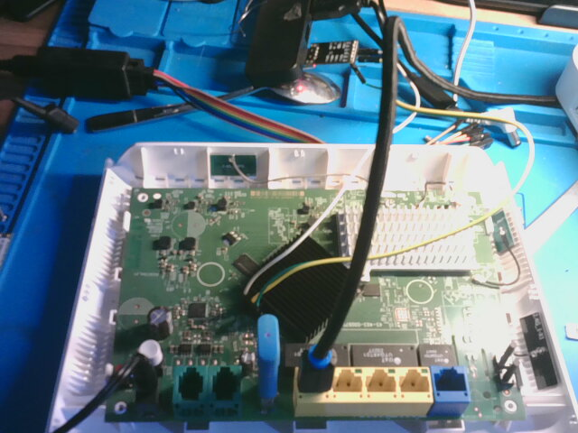

# ex3301-godmode — persistent root + full Web UI for the Zyxel EX3301-T0

One Python script. No blobs, no firmware mods, no flash writes. It turns the
ISP-locked EX3301-T0 (Hyperoptic Hyperhub and siblings) into a box you fully
control: UID-0 SSH on the LAN, every hidden admin page restored, and automatic
re-rooting after every reboot.

## What it does

- **Root:** flips the live `admin` account to UID 0 / `/bin/sh` via the
  authenticated TR-369 certificate-copy endpoint, starts Dropbear SSH bound
  to the LAN plus a firewall rule. Verified: `uid=0(root) gid=0(root)`.
- **Unhide:** patches the served `app.js` in memory (bind-mount) — forces the
  `hide*` GUI flags off and re-adds all 45 server-stripped menu entries whose
  pages exist in the build (Remote Management with FTP/TELNET/SSH rows, xDSL
  Statistics, SIP/Phone/Call Rule, Broadband, Multicast, Time, SNMP, Firmware
  Upgrade, …). 12 entries whose routes are compiled out of this ISP build are
  deliberately omitted so every visible menu item works.
- **Persist:** a logrotate hook on a USB stick re-applies everything at boot;
  a Deck-side watcher (`watch` / systemd service) re-runs the restore
  automatically. Validated end-to-end across real power cycles.

## Requirements

- The router, a USB stick (any size, FAT32), this machine on the LAN.
- Python 3, `requests`, `pycryptodome`: `pip install requests pycryptodome`
- Your router's **admin** password (asked interactively, never stored —
  or pass `--password-file` / `$ZYXEL_ADMIN_PASSWORD` for automation).

## Tested on / firmware

Developed against a second-hand **EX3301-T0 bought on eBay**, stock
Hyperoptic (ISP) firmware:

| Item | Value |
|---|---|
| Firmware | `V5.50(ABVY.5.5)b6_Y0` |
| Kernel | 3.18.21 (EcoNet EN751627, dual MIPS 1004Kc) |
| Rootfs | 25 MB LZMA squashfs on SPI NAND, tmpfs `/etc` |
| Build | OpenWrt-derived (GCC 4.8.1), 14 MTD partitions |

The TR-369 handler and the `app.js` mutation/menu structures are what the
patch depends on. `stage` verifies both anchors and aborts cleanly if a
different firmware build doesn't match — it will not write a payload it
can't verify. Newer ABVY builds (6.x+) are reported to drop the endpoint
entirely, so this is likely a 5.x-only technique.

## Hardware



Board notes: EcoNet EN751627 SoC under the central heatsink, MT7915D WiFi
under the shield can (yellow lead = antenna), Winbond W25N01G 128 MB SPI
NAND as the 8-pin flash chip, 4× GbE LAN + 1× WAN RJ45, 2× FXS phone jacks,
USB3, and **no DSL jack** on this ETH-WAN variant despite DSL code in the
firmware. The rainbow Dupont wires are the UART tap used for the serial
console.

## Usage

```bash
# 1. Stick in the ROUTER, copy the live account file onto it:
./zyxel-godmode.py extract

# 2. Stick in THIS machine, build the payload (needs the router for stock UI files):
./zyxel-godmode.py stage /run/media/$USER/ROUTERSTICK

# 3. Stick back in the ROUTER, install the hook and wait for root (~5 min):
./zyxel-godmode.py restore

# 4. Optional: auto-restore service on this machine (needs a password file):
./zyxel-godmode.py --password-file ~/.zyxel-admin install

# Check state any time:
./zyxel-godmode.py --password-file ~/.zyxel-admin status
```
(Global options `--host` / `--password-file` / `--yes` go before the command.)

After step 3: `ssh admin@192.168.1.1` → `#`. Reboots self-heal (manually via
`restore`, or automatically with the watcher).

## How it works (30 seconds)

The `/cgi-bin/TR369Certificates?action=download` endpoint builds
`cp /data/usp/cert/<name> <tmp>` with a 128-byte buffer. A padded `name`
with spaces turns it into `cp <src> <dst>` with the temp destination
truncated away — an authenticated arbitrary file copy. We use it only to
copy router files onto the removable USB stick and to drop a logrotate
config + trigger there. The stock 5-minute logrotate job then runs our
USB payload as root, which restores the UID-0 passwd, SSH, and the UI
patch. Live `/etc/passwd` is a tmpfs file; flash is never written.

## Safety notes

- **Ownership first.** Check whether you or your ISP owns the device before
  running anything. If the router is ISP-supplied (typical for Hyperoptic
  units), modifying it may breach your contract — see the legal section.
  This repository was developed and tested on a second-hand unit bought on
  eBay specifically to avoid that situation.
- **Everything here is reversible.** No router flash or NVRAM is written:
  the passwd change, SSH service, firewall rule, and UI patch live in RAM
  (tmpfs). Unplug the USB stick and reboot and the router returns to stock
  with your original configuration intact. That's also why a failed attempt
  can't brick it.
- A reboot always returns the router to stock except for the USB payload.
  Unplug the stick + reboot = provider-pristine box (plus your config).
- Every state-changing command (`extract`, `stage`, `restore`) requires
  typing `I OWN THIS DEVICE` unless `--yes` is passed.
- Back up first: `stage` refuses to run without a valid base passwd, and
  the script never overwrites existing payload files blindly — re-run from
  a fresh stick if in doubt.
- Changing the admin password afterwards is recommended; update your
  password file so the watcher keeps working.

## Legal — read this

- **Only use this on devices you own or are explicitly authorised to test.**
  Unauthorised access to computer systems is a criminal offence in most
  jurisdictions (including, without limitation, the UK Computer Misuse Act
  1990, the US Computer Fraud and Abuse Act, and EU member-state
  equivalents). If the router belongs to your ISP, check your contract —
  modifying ISP-supplied equipment may breach it and may void warranties.
- This software is provided for **education, research, interoperability,
  and administration of your own equipment only**. It is not intended to
  facilitate wrongdoing, bypass lawful access controls on systems you do
  not own, or interfere with your provider's network.
- The authors provide this **"as is", without warranty of any kind**, and
  accept **no liability** for bricked devices, data loss, loss of service,
  or any legal consequences. You assume all risk. See LICENSE.
- Do not use this tool to attack, probe, or disrupt ISP infrastructure or
  any third-party system. Observing traffic to/from your own device is your
  business; anything beyond that is not covered here.
